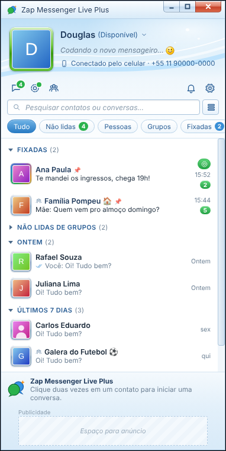
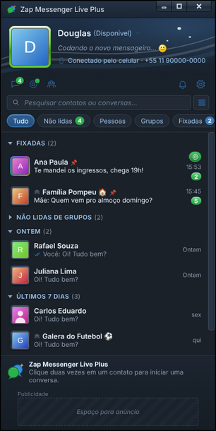

  

<h1 align="center">Zap Messenger</h1>

<b>O seu WhatsApp com a cara do bom e velho MSN.</b> 
Telas no estilo do Windows Live Messenger 2009, com um toque moderno. Para Windows, Linux e Mac.

  
  
  
  

  
  &nbsp;
  

## Baixar

**[Baixar a última versão](https://github.com/DougPomp/ZapMessengerLivePlus-Updates/releases/latest)** e escolher o arquivo do seu sistema:

| Sistema | Arquivo | Como instalar |
| --- | --- | --- |
| Windows | `.exe` | Dar dois cliques. Se aparecer o aviso do SmartScreen: **Mais informações > Executar assim mesmo** |
| Mac (Intel e Apple Silicon) | `.dmg` | Arrastar para Aplicativos e abrir com **clique direito > Abrir** na primeira vez |
| Linux | `.AppImage` | Dar permissão de execução (`chmod +x`) e abrir |
| Linux (Debian, Ubuntu) | `.deb` | `sudo apt install ./arquivo.deb` |

Os instaladores ainda não são assinados digitalmente, por isso os avisos acima.

Na primeira vez, abra o app e escaneie o QR code com o WhatsApp do celular
(**Aparelhos conectados > Conectar um aparelho**), como no WhatsApp Web.

## Atualização automática

O app procura versões novas ao abrir e a cada 4 horas, baixa sozinho e pergunta se você quer reiniciar
(ou instala quando você sair). Também dá para procurar manualmente pelo menu ⚙ ou pelo ícone da bandeja.
Você não precisa baixar nada de novo.

No **Mac** a atualização automática ainda não funciona (exige assinatura paga da Apple): baixe o `.dmg` novo desta página.

## O que o app faz

- Entrada com QR code ou código de 8 letras, até 3 contas WhatsApp.
- Lista de contatos com filtros, busca, etiquetas do WhatsApp e conversas fixadas.
- **Temas personalizáveis** (⚙ > Tema): Claro, Escuro, Clássico 2009 e Meu tema, com 8 cores, fonte, tamanho e imagem de fundo; dá para exportar, importar e voltar ao padrão.
- **Emoticons personalizados** e **winks** (animações de tela cheia; no celular de quem não usa o app aparece só o texto "✨ Wink: Nome").
- Uma janela por conversa no formato "Fulano diz:", emoticons, **chamar atenção** (a janela treme) e "está digitando...".
- Responder, reagir, editar, apagar, encaminhar, favoritar, enquetes, localização, contato, @menções, mensagens de voz, figurinhas e GIFs.
- Status, grupos, canais, comunidades, privacidade e WhatsApp Business (perfil e catálogo).
- Aviso de chamada recebida (atender continua sendo no celular), conversas trancadas com senha do app.
- Sons e avisos no canto da tela, bandeja com contador de não lidas.

  

## O que vem depois

Algumas coisas o WhatsApp Web não permite (atender chamadas, dispositivos vinculados, mensagem de ausência e saudação, listas de transmissão, Favoritas do WhatsApp novo). Elas serão tratadas mais para a frente, quando for construída a API própria do projeto.

## Novidades da última versão (0.3.48)

- Em **Meu tema** no escuro, a cor do texto escolhida vale também nas mensagens recebidas e nas linhas de apoio.

## Histórico de versões

Esta página guarda só a versão mais nova para baixar (e só os instaladores); as anteriores ficam registradas aqui.

| Versão | Data | Novidades |
| --- | --- | --- |
| 0.3.48 | 24/10/2026 | Meu tema no escuro: a cor do texto vale nas mensagens recebidas e nas linhas de apoio |
| 0.3.47 | 24/10/2026 | Correções de segurança: link do mapa, comandos da ponte, espera após senha errada de conversa trancada, números mascarados nos logs |
| 0.3.46 | 24/10/2026 | Meu tema também no escuro; submenus do ⚙ abrem ao lado do item |
| 0.3.45 | 24/10/2026 | O nome passa a ser só **Zap Messenger** (seus dados e sessões continuam como estavam) |
| 0.3.44 | 24/10/2026 | Temas personalizáveis, emoticons personalizados e winks; some o ícone verde de status da lista |
| 0.3.43 | 24/10/2026 | Botão Voltar na tela de QR code ao adicionar ou trocar de conta |
| 0.3.42 | 23/10/2026 | O toque e o tremor da chamada recebida param quando a chamada acaba no celular |
| 0.3.41 | 23/10/2026 | Alerta de chamada recebida mais forte: a janela chacoalha e toca até a chamada acabar |
| 0.3.40 | 23/10/2026 | Correções na galeria e no catálogo; X para limpar a busca |
| 0.3.39 | 23/10/2026 | Ícones na barra da conversa: mídia, links, documentos, favoritas, perfil comercial e catálogo |
| 0.3.38 | 23/10/2026 | Velocidade do áudio (1x, 1,5x, 2x), perfil comercial e catálogo de produtos |
| 0.3.37 | 22/10/2026 | Correções de estabilidade: sessão ao trocar de conta, histórico e conexão |
| 0.3.36 | 22/10/2026 | Limite de 3 conversas fixadas; filtro "Pessoas" sai do topo |
| 0.3.35 | 22/10/2026 | "Chamar atenção" volta a tremer no Linux |
| 0.3.34 | 22/10/2026 | Aviso de chamada, histórico de chamadas, conversas trancadas, respostas rápidas do Business |
| 0.3.33 | 21/10/2026 | Canais, comunidades e privacidade (esta versão não tem instalador para Mac) |
| 0.3.32 | 21/10/2026 | Mensagem de voz, figurinhas e GIFs, prévia de link, visualização única |
| 0.3.31 | 21/10/2026 | Grupos: criar, administrar, link de convite |
| 0.3.30 | 21/10/2026 | Postar status, trocar nome e foto, entrar com código |
| 0.3.29 | 20/10/2026 | Enquetes, localização, contato, @menções, mensagens temporárias |
| 0.3.28 | 20/10/2026 | Botão direito na lista: silenciar, arquivar, bloquear e mais |
| 0.3.27 | 19/10/2026 | Responder, reagir, editar, apagar, encaminhar e favoritar |
| 0.3.19 a 0.3.26 | 18 a 19/10/2026 | Etiquetas do WhatsApp, estabilidade e acabamentos |
| 0.3.0 a 0.3.18 | 16 a 18/10/2026 | Instalador, atualização automática, mídia, status, avisos, multiconta |

Os instaladores da versão mais nova estão na página de [Releases](https://github.com/DougPomp/ZapMessengerLivePlus-Updates/releases/latest).

## Sobre

Este repositório guarda **apenas os instaladores e as atualizações**. O nome do repositório e a pasta de dados do app ainda usam "Live Plus" de propósito, para ninguém perder a sessão. O código-fonte é privado.
O Zap Messenger não é afiliado ao WhatsApp, à Meta nem à Microsoft; o logotipo é original.
